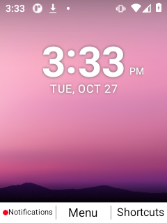
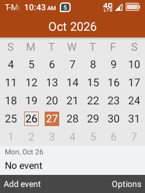
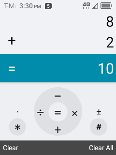

# KaiDroid

KaiDroid is an Android 11 port for keypad flip phones, starting with the Nokia
2760 Flip (N139DL). The project brings Android to hardware originally designed
for KaiOS, with an interface and everyday navigation modeled on TCL flip phones.

The goal is a phone that works naturally through its D-pad, number keys and
physical buttons. That means adapting the Android framework as well as the
apps: menus, dialogs, text entry, focus movement, shortcuts, lock screen, and
flip-open/close behavior all need to work together. The intended design pairs
TCL navigation with a Kyocera soft-key layout.

## What is being developed

- **Device support:** Android product configuration, startup services, keypad
  mapping, display behavior, memory management, and hardware integration.
- **Keypad interface:** framework widgets, three-button soft keys, dialogs,
  title editors, input-method integration, and SystemUI changes.
- **Application compatibility:** adapters and development tools for the TCL
  application experience, including contacts, messaging, calendar and utilities.
- **Visual reference:** screenshots of the TCL interface and successive Nokia
  builds, used to compare layouts and follow the port's development.

## Screenshots

| Nokia port | TCL Calendar reference | TCL Calculator reference |
| --- | --- | --- |
|  |  |  |

[Browse the screenshot collections](screenshots/README.md).

## Development status

Experimental Android builds have booted on the N139DL. Full hardware support
and matching the TCL UI and UX are still in development; screenshots include
intermediate builds and known issues.

This repository contains port source, patches, configuration and development
tools. Building requires a matching Android source checkout and separately
supplied device/vendor inputs. There is no installable firmware release here yet.

Original KaiDroid additions are currently unlicensed. Existing third-party
attribution and terms are retained in [NOTICE](NOTICE) and the source files.
