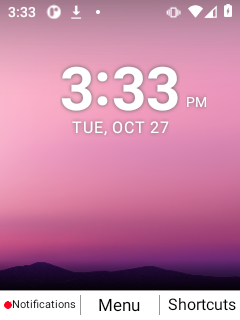
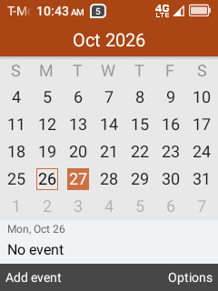
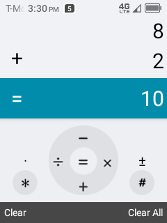

# Interface captures

Screenshots from TCL reference phones, Nokia port builds, and UI development.
The collections show app screens, keypad menus, dialogs, text entry, and visual
comparisons across builds. Some captures show intermediate layouts or known
issues rather than the finished interface.

The complete image inventory is in [index.json](index.json).

## Examples

| Nokia port launcher | TCL Calendar reference | TCL Calculator reference |
| --- | --- | --- |
|  |  |  |

## Collections

- [Original TCL app editors](2026-10-27-tcl-app-editors/)
- [Original TCL app navigation](2026-10-27-tcl-app-workflows/)
- [Original TCL Clock and Settings](2026-10-27-tcl-clock-settings/)
- [Original TCL Calculator](2026-10-27-tcl-calculator/)
- [Nokia image60 Calculator](2026-10-27-image60-calculator-functional/)
- [Nokia image59 Clock](2026-10-27-image59-clock/)
- [Nokia image59 Notes](2026-10-27-image59-notes-functional/)

Directory names retain their capture/build labels. They are historical
collections rather than a statement about the currently installed phone.
